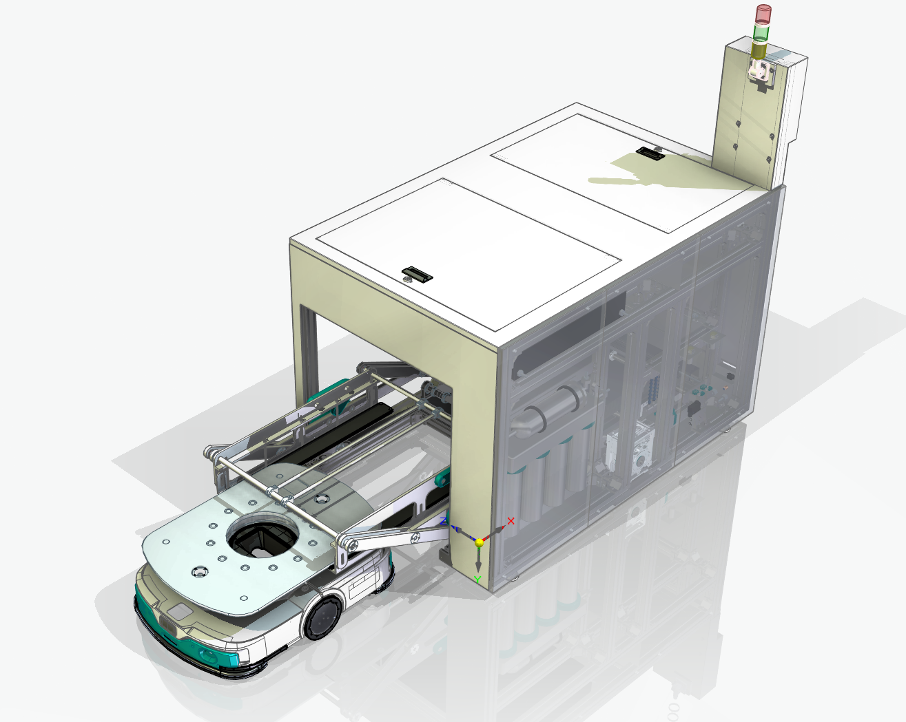

# 项目名称

> 简短的项目描述（一句话）

## 目录结构
- `Body/` -存放主要内容
- `Note`  -存放零时想法

## 使用方法（包括INDEX）
# 2025-001-AGV洗轮机

> AGV小车底轮自动清洗设备
### 效果图

### 项目简介

本项目设计了一款**AGV小车底轮自动清洗机**，采用**摇臂圆周运动**原理，将水平移动和竖直抬升合二为一，极大简化了机械结构。

### 主要亮点

- **摇臂式抬升机构**：单电机驱动摇臂实现小车抬升+平移，结构简单、成本低、可靠性高
- **毛刷带自清洁**：通过不同速比的毛刷辊，在清洗小车底轮的同时对毛刷带进行自清洁，避免二次污染
- **吹干功能**：清洗后通过高压气吹干底轮，解决传统方案干燥不彻底的问题
- **高度可调节托板**：可适配不同高度的AGV小车，适应性强
- **水循环系统**：支持内循环或外循环方案，节约用水
- **统一接口设计**：水、电、气接口全部集中在前左下角，便于集成和管理

### 主要参数

- **整机尺寸**：1675mm（长）× 1114mm（宽）× 1140mm（高）
- **载荷能力**：≤ 100kg
- **适用小车底轮宽度**：≤ 650mm
- **适用底轮间距**：≤ 760mm
- **托板高度调节范围**：约 235mm ± 40mm

### 解决的问题

- 解决AGV小车底轮清洗难题
- 解决水平+竖直复合运动的复杂控制问题
- 解决清洗后底轮干燥不彻底的问题
- 解决不同尺寸小车的适配问题
- 降低设备体积、成本和维护难度

## 保留内容

### logo与作者

- 作者：pinavia
- 

### 学习许可与权利保留

- 本项目允许个人、学校和研究者进行非商业性的学习、研究和引用。
- 未经著作权人书面许可，不得将项目内容用于商业开发、产品制造、商业服务、商业宣传、投标交付、毕业设计成品交付或再授权。
- 不得删除作者、来源、版本历史和第三方许可证声明，不得将本项目或其衍生成果宣称为与作者无关的原创项目。
- 软件源码适用 [PolyForm Noncommercial 1.0.0](https://polyformproject.org/licenses/noncommercial/1.0.0/)；机械模型、PCB、原理图、图片、文档、Unity 工程和其他非软件资料适用 [CC BY-NC-ND 4.0](https://creativecommons.org/licenses/by-nc-nd/4.0/)。
- SE、SW、STEP/STP 及其他三维模型仅允许个人或学校进行非商业学习、评审和研究；未经著作权人书面许可，不得用于加工、打样、制造、销售、量产、投标、产品交付、商业宣传、改作或再授权。
- 第三方组件、模板、元件库、外购件模型和工具仍受其原始许可证约束；本声明不扩大作者对第三方内容的权利。

商业使用、产品化、公司内部长期使用、转让或排他性授权需另行取得著作权人的书面许可。
